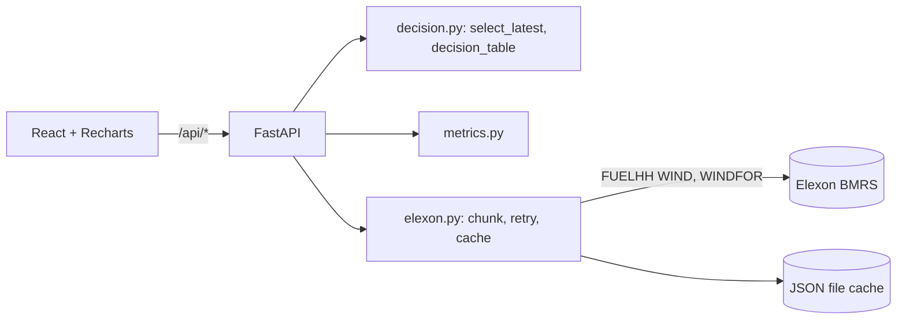

# Technical review

## Data flow
Request → fetch actuals (FUELHH, WIND) and forecasts (WINDFOR, from 3 days before the first delivery day) in chunked windows → normalise (UTC, numeric, dedupe) → for each delivery day D build 24 half-hour slots, select the forecast per slot → left-join actuals → compute horizon and error → metrics/aggregations → JSON.

## Decision-time selection
`cutoff(D) = (D-1) + cutoff_time (UTC)`. Per `startTime`: filter `publishTime <= cutoff`, sort by `publishTime`, keep last. Left-join onto the 48 slots so gaps stay visible. Tests: boundary (equal to cutoff allowed, +1 min excluded), randomised no-leakage property, all-NaN when everything is published after cutoff.

## Metric formulas
See README. Percentiles use numpy linear interpolation. Buffer = P_q(max(e,0)).

## Decisions and trade-offs
- Disk cache keyed by request hash: simple, no DB; not shared across instances.
- Whole-month pandas computation per request: simple and fast enough for ~1.5k rows.
- Horizon filter applied after selection to keep selection semantics clean.
- Chunk sizes conservative and configurable because live limits were unverified.

## Testing
8 pytest tests (selection, no-leakage, missing data, horizon, metrics, MAPE guard, buffer floor, dedupe/chunking), run offline via a stub runner.
The January 2026 live run showed WINDFOR is hourly; slot generation was corrected from 48 to 24 per day

## Limitations / next steps
Verify against live API; HTTP client tests with mocked responses; frontend tests; cutoff presets and side-by-side cutoff comparison; regime-dependent buffers; shared cache.
