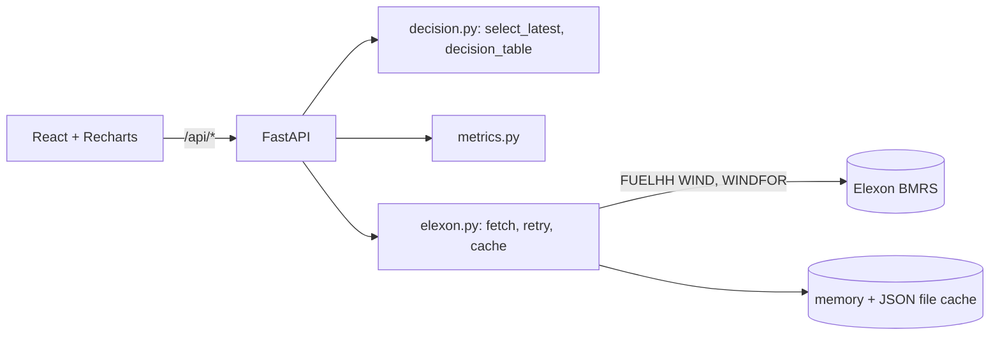

# Technical review

## Data flow
On the first request the backend downloads the fixed January window with one request per dataset:
- **WINDFOR:** published 2025-12-29 00:00 to 2026-01-31 00:00 UTC.
- **FUELHH WIND:** published 2026-01-01 to 2026-02-01 UTC.

Both are normalised (UTC timestamps, numeric generation, duplicates removed) and kept in memory. A lock makes concurrent first requests share one download, and a JSON file cache backs it up. Every endpoint then filters this data in memory.

The stream endpoints filter on publish time, inclusive at both ends. In live checks (October 2026) one call returned 123 days of WINDFOR publishes and 32 days of FUELHH, so the chunk sizes now default to 40 and 35 days. Both are still configurable by env, and retries with backoff are unchanged.

## Slots and the join
- **WINDFOR is hourly:** every `startTime` is on :00. FUELHH is half-hourly: 48 values per day.
- Each delivery day D therefore has **24 hourly slots**. Each slot is left-joined to the FUELHH actual with the same `startTime`.
- The :30 actuals have no forecast and are not scored. Forecasts are never interpolated.
- In January all 744 slots have both a forecast and an actual.

## Decision-time selection
- `cutoff(D) = (D-1) + cutoff_time (UTC)`, with a default of 09:00.
- For each `startTime`: keep forecasts with `publishTime <= cutoff`, sort by `publishTime`, keep the last.
- Slots with no eligible forecast stay in the table as NaN, so gaps are visible.
- Only forecasts published within 3 days before the first delivery day are eligible. This is enough because the latest run before any cutoff is at most about 42 hours ahead.

**Why 09:00 is the default:**
- GB day-ahead gate closure is 09:50 GMT (Nord Pool N2EX), and GMT = UTC in January.
- WINDFOR runs are published at about 02:30, 04:30, 07:30 and 09:30 each morning, so a 09:00 cutoff uses the 07:30 run.

| Cutoff | Mean lead time | MAE | RMSE | Bias | \|e\| P90 |
|---|---|---|---|---|---|
| 04:30 | 31 h | 2,128.6 | 2,632.0 | +1,798.0 | 4,379.1 |
| **09:00** | 28 h | 2,127.5 | 2,606.1 | +1,851.5 | 4,306.4 |
| 09:30 | 26 h | 2,107.2 | 2,611.2 | +1,839.9 | 4,377.0 |

All values are MW, for all 744 January slots. The later run barely helps and leaves 20 minutes before gate closure. `/api/metrics` returns this comparison as `cutoff_comparison`, and the cutoffs it compares are configurable via `COMPARE_CUTOFFS_UTC`.

**Tests:**
- Equal-to-cutoff publish is allowed and +1 minute is excluded.
- A randomised no-leakage property test.
- All-NaN output when everything is published after the cutoff.
- The comparison picks a different run for each cutoff.

## Metric formulas
error e = forecast − actual, so positive means wind was over-forecast.
- MAE = mean|e|, RMSE = sqrt(mean e²), Bias = mean e.
- MAPE = mean(|e|/|actual|)·100 over slots with |actual| > 1 MW.
- P50/P90/P95/P99 of |e| use numpy linear interpolation.
- Horizon = startTime − publishTime, grouped into 6 h bins.

**Buffer:**
- Buffer = P_q(max(e, 0)), and conservative wind = max(forecast − buffer, 0).
- The bias-aware fields split this into the bias and a residual buffer, P_q(max(e − bias, 0)).
- In January at P90 this gives 1,851.5 + 2,454.9 MW against the 4,306.4 MW total.
- Both parts are estimated on the same month (in-sample).

## Forecast bias (cause not verified)
Forecasts were above actuals in 631 of 744 January hours, and bias is positive in every horizon bin, at +1,468 to +2,382 MW. Possible explanations, **none verified**:
- Curtailment of wind output, which would reduce metered generation relative to an unconstrained forecast.
- A coverage difference between the units in WINDFOR and those reported in FUELHH WIND.
- Genuine forecast error in a windy month.

The app reports the bias and does not correct for it automatically.

## Decisions and trade-offs
- **One fixed-window fetch per dataset, shared by all endpoints.** This avoids per-request Elexon calls. A cold page load used to make 18 Elexon calls, plus 2 more for each new delivery day picked; now the whole app makes 2 per process.
- **Memory + file cache, no database.** It is simple, but not shared across instances and lost on a free-tier restart.
- **Whole-month pandas computation per request.** This is fast enough for 744 slots.
- **Additive API changes only** (`cutoff_comparison` and the bias-aware buffer fields), so the existing frontend and backend stay compatible during rollout.

## Testing
13 pytest tests cover:
- Selection and no-leakage.
- Missing data and horizon.
- Metrics and the MAPE guard.
- The buffer floor and the bias-aware buffer.
- The cutoff comparison.
- Ignoring :30 actuals.
- Single-request chunking.
- Fetching once under concurrent requests.

The backend was also run end-to-end against a snapshot of the live Elexon data. Existing response fields were identical to the deployed version's output, which matches raw Elexon values (e.g. 15 Jan 12:00: forecast 11,049 MW, actual 9,742 MW).

## Limitations / next steps
- One month of history only, so the buffer is in-sample.
- No UI tests, and no tests against the live Elexon API.
- Next steps: confirm the client's real decision time, extend history to an out-of-sample buffer, and run regime-dependent buffers (e.g. high vs low wind).
